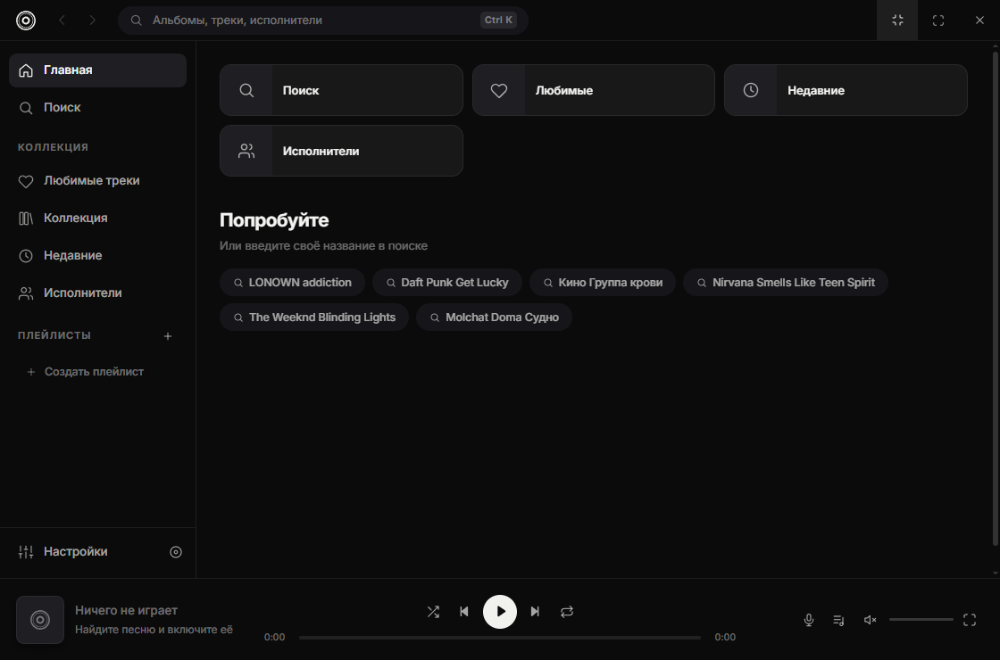
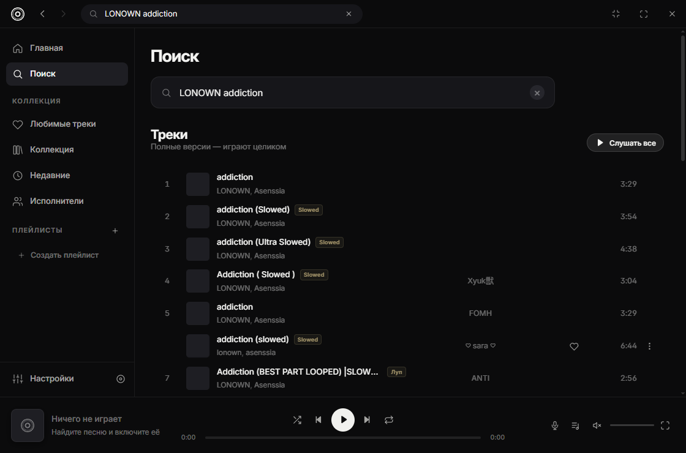
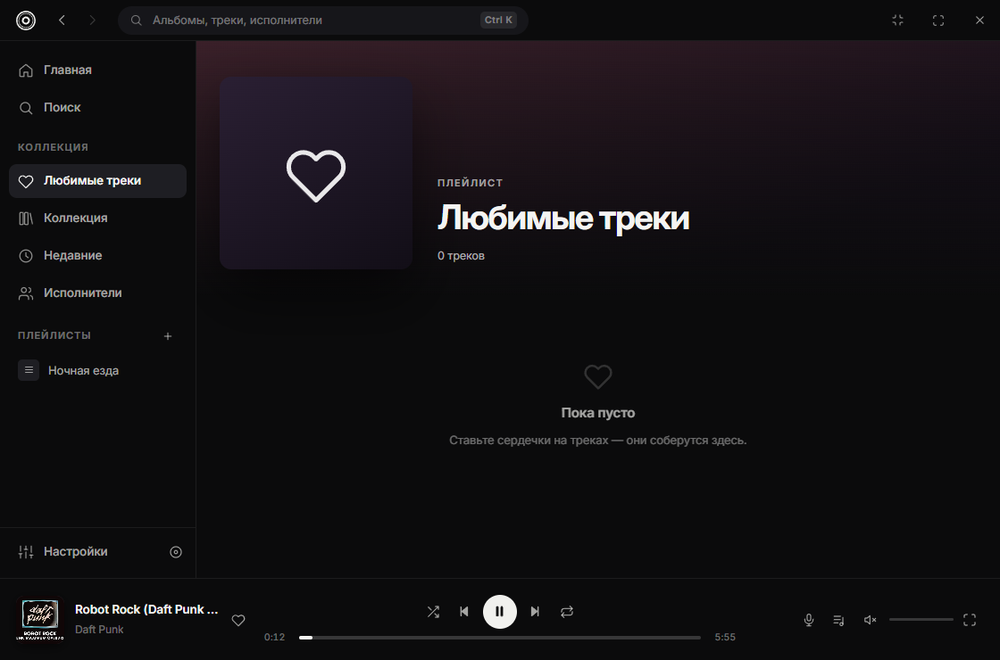
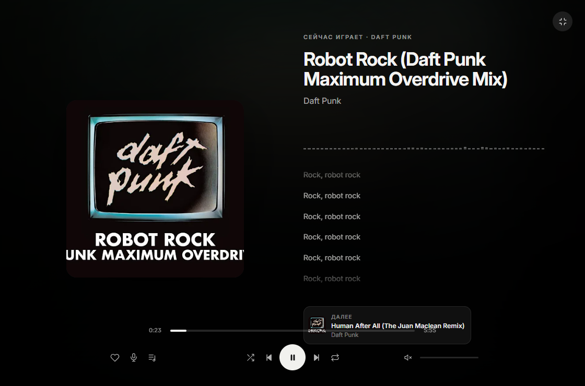
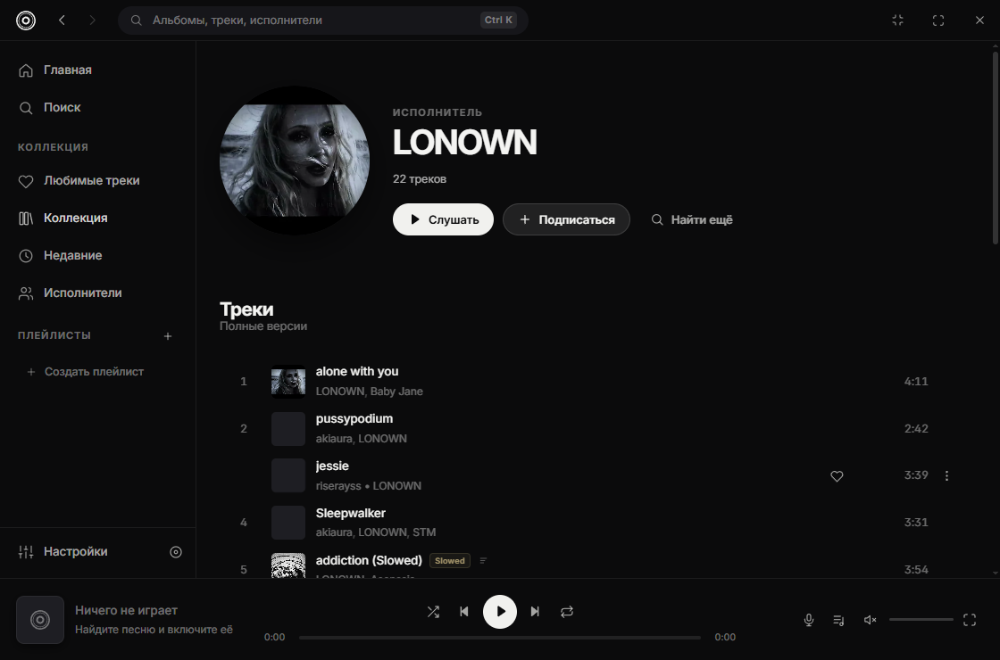
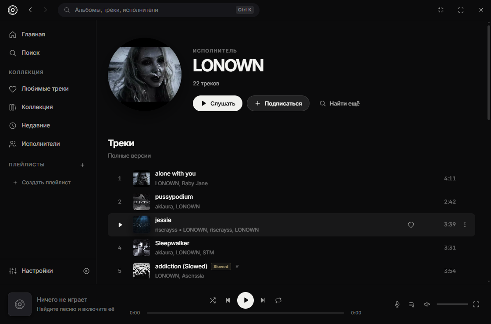
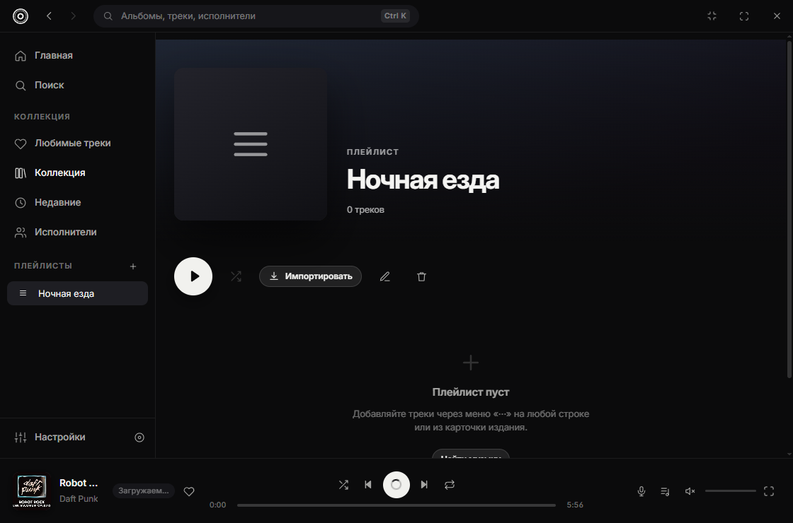
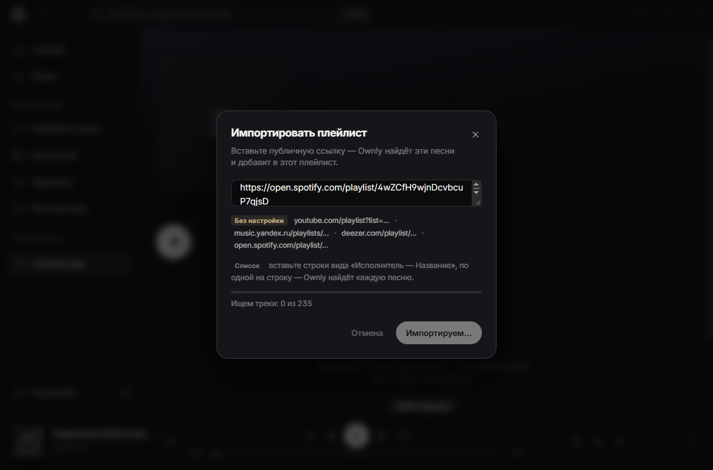
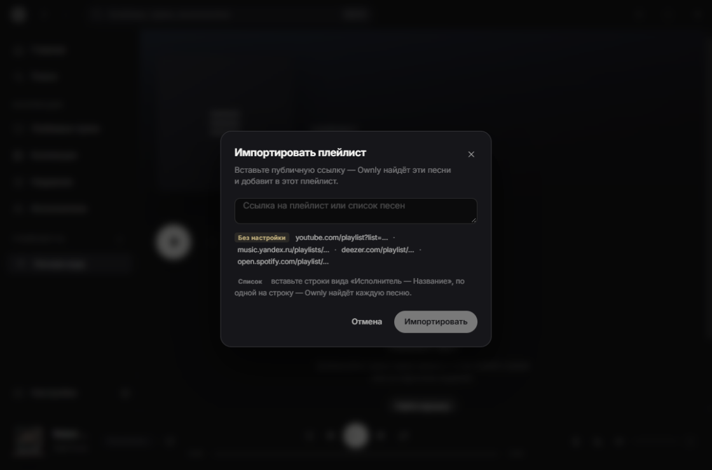

# Ownly

**Десктопный плеер для поиска и прослушивания музыки из публичных каталогов.**

<p align="center">
  
</p>

---

## Что это

Введите название — Ownly найдёт запись и включит её целиком. Без регистрации,
без токенов, без аккаунтов.

**Принципиально нет:**

- ❌ загрузки музыки из файлов, добавления папок, локальных библиотек;
- ❌ превью и фрагментов — любой трек играет от начала до конца;
- ❌ рекламы и телеметрии;
- ❌ клипов и часовых лупов в поиске — только песни.

---

## Возможности

### Поиск

- Одно поле — ищет по названию, исполнителю и изданию
- Результаты приходят меньше чем за секунду
- Отбрасывает клипы, интервью, часовые лупы и миксы: остаются песни
- Несколько исполнителей в треке — каждый кликабелен и ведёт на свою страницу
- Отклонения от оригинала помечены прямо в строке: Slowed, Sped Up, Ремикс,
  Луп. Оригинал не помечается — иначе плашка стояла бы почти на каждой строке
- Иконка текста — если для песни он найдётся
- Полный состав исполнителей. YouTube подписывает ролик так, как захотел
  загрузивший: «addiction» у канала LONOWN, хотя песню сделали вдвоём. Ownly
  спрашивает кредиты у каталога Deezer (публичный API, без аккаунта) и
  показывает `LONOWN, Asenssia` — в списке, в плеере и в полном экране.
  Каждое имя кликабельно и ведёт на свою страницу



### Плеер

- Полноценное воспроизведение с очередью, перемешиванием и тремя режимами повтора
- Плавный seek, громкость с перцептивной кривой
- Поток следующего трека резолвится заранее — переход без паузы
- Ссылки на потоки кэшируются на диск: повторное включение мгновенное
- Медиа-клавиши и системный оверлей (Media Session API)
- Горячие клавиши: пробел, стрелки, `S`/`R`/`L`/`F`, `Ctrl+K`

| Очередь | Полноэкранный плеер |
| --- | --- |
|  |  |

### Исполнители

Страница исполнителя — треки, подписка, переход к поиску. Открывается меньше
чем за секунду.



### Discord Rich Presence

Один переключатель в настройках — приложение Ownly в Discord уже создано, свой
Application ID не нужен. Показывает название, исполнителя, обложку и полосу
прогресса. Соединение восстанавливается само, если Discord перезапустился.



### Коллекция

- Любимые треки, плейлисты, история, подписки
- Плейлисты — полкой обложек, как в стриминговых сервисах: мозаика из четырёх
  обложек, счётчик треков, создание с первого тайла
- Всё хранится локально и переживает перезапуск



### Импорт плейлиста по ссылке

Внутри плейлиста кнопка **Импортировать**: вставляете ссылку — Ownly находит
каждую песню и добавляет в этот плейлист. Ни аккаунтов, ни ключей не нужно.

| Источник | Ссылка | Проверено |
| --- | --- | --- |
| **YouTube / YouTube Music** | `youtube.com/playlist?list=…` | 182 трека |
| **Яндекс Музыка** | `music.yandex.ru/playlists/…` | 788 из 820 |
| **Deezer** | `deezer.com/playlist/…` | 50 треков |
| **Spotify** | `open.spotify.com/playlist/…` | 235 треков · первый раз ~12 с, дальше мгновенно |
| **Список вручную** | строки «Исполнитель — Название» | 3 из 3 |

Только ссылка. Ни аккаунта, ни Client ID, ни Secret, ни регистрации приложения
— ни для одного источника. Список вручную остаётся универсальным запасным
путём: скопируйте названия откуда угодно, по одной строке, и Ownly подберёт
каждую песню в каталоге.

### Spotify

Тоже только по ссылке. Ключи не нужны, потому что веб-клиент Spotify сам
читает публичные плейлисты анонимно — так же это делают
[`AliAkhtari78/SpotifyScraper`](https://github.com/AliAkhtari78/SpotifyScraper),
[`tr1ckydev/spotifly`](https://github.com/tr1ckydev/spotifly) и
[`kaangiray26/noauth`](https://github.com/kaangiray26/noauth).

Страница-эмбед отдаёт анонимный bearer-токен вместе с первыми 100 треками:

```
open.spotify.com/embed/playlist/<id>
  → props.pageProps.state.settings.session.accessToken
  → props.pageProps.state.data.entity.trackList   (первые 100)
```

Обрезка на 100 — важно: тот самый плейлист на 235 треков через эмбед выглядел
как 99 (часть строк эмбед не отдаёт). Поэтому токен идёт дальше, в тот же
запрос, которым пользуется сам веб-плеер:

```
GET api-partner.spotify.com/pathfinder/v1/query
    ?operationName=fetchPlaylist
    &variables={"uri":"spotify:playlist:<id>","offset":0,"limit":100,…}
    &extensions={"persistedQuery":{"version":1,"sha256Hash":"a65e1219…"}}
Authorization: Bearer <токен>   app-platform: WebPlayer
```

`totalCount` в ответе даёт полное число треков, страницы по 100 собираются до
конца. Исполнители приходят массивом, а не строкой через запятую, — поэтому
кредиты не ломаются на «Tyler, The Creator». Токен кешируется до истечения,
так что повторные импорты не ходят никуда лишний раз.

**Если Spotify отказывает вашей сети.** Из некоторых стран страница-эмбед
отвечает `pageProps.status = 451` — «This content is not available in your
country». Тогда она запрашивается через публичный релей, который забирает её из
региона, где Spotify работает (`cors.eu.org`, `test.cors.workers.dev`,
`api.allorigins.win`). Через релей уходит только ссылка на публичный плейлист —
ничего из вашей библиотеки и никаких данных о вас. `api-partner.spotify.com`
при этом не блокируется, поэтому токен из релея используется напрямую.

Публичные релеи бесплатные и общие: они ограничивают частоту запросов и мигают
между «работает» и «перегружен». Поэтому Ownly не полагается на один запрос —
он перебирает релеи по одному (параллельная пачка блокирует их все) и повторяет
проход, пока не истечёт бюджет в 40 секунд. Первое чтение из-за этого занимает
до нескольких секунд, проверено — 12 с на 235 треках.

Дальше это уже неважно: токен анонимного доступа живёт месяцами, Ownly
сохраняет его на диск, и все следующие импорты идут напрямую в
`api-partner.spotify.com` без посредников. Если первая попытка всё же не прошла,
Ownly сам повторит её в фоне (через 1,5, 5 и 15 минут), и следующий импорт
сработает сразу.

Так проверено: плейлист на 235 треков — 12,3 с, «All Out 80s» — ровно 150 из
150 (эмбед показывал 100).

Если и это не сработало, Ownly честно пишет, что Spotify не отдал плейлист, и
предлагает Deezer, YouTube или Яндекс Музыку — ключи и настройки тут не
помогут, это блокировка на стороне Spotify.





### Тексты

- Синхронизированные тексты с подсветкой текущей строки
- Клик по строке перематывает трек
- Тайминги автоматически подстраиваются под замедленные и ускоренные версии;
  если это другая аранжировка — текст показывается без ложной синхронизации

---

## Запуск

Нужен **Node.js 20+**.

```bash
npm install
npm start          # сборка + запуск приложения
```

Разработка с горячей перезагрузкой:

```bash
npm run dev:desktop   # Vite + Electron вместе
```

> Если `electron` не скачал бинарник при установке (бывает за прокси),
> выполните `node node_modules/electron/install.js`.

### Проверки

```bash
npm run build           # renderer в dist/
npm run typecheck       # проверка типов
npm run smoke           # 7 автотестов на живом приложении
npm run e2e             # поиск, воспроизведение, исполнитель — с замерами времени
npm run shoot           # скриншоты всех экранов в .shots/
```

---

## Архитектура

```
electron/
  main.cjs          главный процесс, окно без рамки, IPC, поиск и поток
  dev/harness.cjs   тестовые сценарии, загружаемые только для smoke/e2e/shoot
  preload.cjs       contextBridge — только безопасный минимум
resources/
  yt-dlp.exe        резервный бинарник; копия обновляется в userData раз в сутки
src/
  lib/              youtube (каталог), тексты, роутер
  state/            zustand-сторы: плеер, коллекция, интерфейс
  components/       оболочка, плеер, панели, UI-кит
  pages/            экраны
  styles/           токены, оболочка, компоненты, страницы
```

**Стек:** Electron 45 · React 19 · TypeScript 5.9 · Vite 7 · Zustand 5.
Никаких UI-библиотек — весь интерфейс написан руками на CSS с переменными.

### Решения, которые стоит знать

- **Поиск не ходит через yt-dlp.** Главный процесс загружает страницу
  результатов обычным `fetch` и разбирает встроенный `ytInitialData`. Первый
  запрос получает небольшой запас времени, второй запускается только через
  800 мс при задержке первого; проигравший запрос отменяется.
- **Поток — через yt-dlp, одним процессом.** Клиенты перебираются внутри
  одного вызова (`android,tv_embedded`); два процесса конкурируют за один
  канал и в итоге работают медленнее. Резервный запуск стартует только если
  первый завис на 6 секунд.
- **Короткие сетевые таймауты.** Соединение с YouTube иногда не устанавливается
  вовсе и висит десятками секунд. `--socket-timeout 2 --retries 2` превращает
  такой случай в быстрый повтор вместо ожидания.
- **Пользователь главнее прогрева.** Клик по треку сбрасывает очередь фонового
  резолва, чтобы не делить с ним канал.
- **Импорт без единого ключа.** YouTube-плейлист читается через yt-dlp и
  собирается напрямую по id видео, без поиска; Яндекс и Deezer отдают публичный
  JSON. Остальное закрывает вставка списком.
- **Кредиты — из каталога, а не из названия ролика.** Deezer возвращает полный
  список исполнителей; совпадение проверяется по названию и длительности, чтобы
  не приписать треку чужого артиста. Ответы кэшируются на 30 дней.
- **Кэш:** поиск — 15 минут, ссылки на потоки — 45 минут в памяти и 3 часа на
  диске, тексты — сутки.

### Обновление yt-dlp

Ownly копирует bundled-бинарник в пользовательский каталог и проверяет обновление
не чаще одного раза в сутки через `yt-dlp -U`. Если копия недоступна, приложение
использует bundled-файл. В релизе бинарник должен поставляться с контрольной
суммой SHA-256 из официального релиза
[yt-dlp](https://github.com/yt-dlp/yt-dlp/releases/latest).

---

## Дизайн

Логотип и палитра из бренд-листа Ownly: знак — одновременно буква «O» и
виниловый диск, собранный из концентрических окружностей на сетке 100×100.

| Токен | Значение | Где |
| --- | --- | --- |
| Ink | `#0B0B0C` | фон, текст на светлом |
| Paper | `#F1F1EE` | акцент, кнопки, «белое» |
| Muted | `#71717A` | вторичный текст |

Правила соблюдены: знак всегда плоский, без градиентов, теней и обводок;
вращение — только в анимации наведения.

Интерфейс: Inter (подрезан до латиницы и кириллицы, 75 КБ), тёмная тема,
радиусы 6–26 px, один акцент — белый.

---

## Замеры

На машине с нестабильным каналом до YouTube (соединение периодически не
устанавливается вовсе):

| Операция | Было | Стало |
| --- | --- | --- |
| Поиск | 6–30 с | **0.6–1.3 с** |
| Старт трека | ~30 с | **4–8 с** (повторно — мгновенно) |
| Страница исполнителя | >60 с | **0.8–1.3 с** |

---

## Лицензия

Код приложения — MIT. Аудио и обложки принадлежат их правообладателям.
